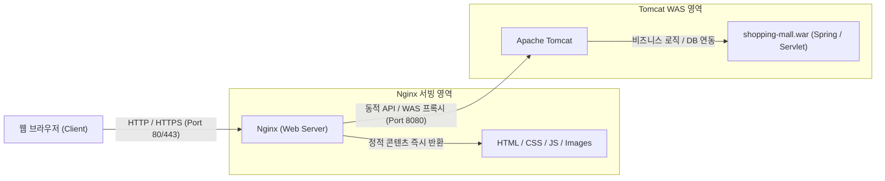

# 🛍️ MyShop - 온라인 쇼핑몰 풀스택 웹 프로젝트

[](#)
[](#)
[](#)
[](#)
[](./LICENSE)

**MyShop**은 모던 이커머스 웹 프론트엔드(WEB)와 자바 백엔드(WAS) 소스코드를 통합 관리하는 표준 엔터프라이즈 프로젝트입니다.  
웹 리소스와 백엔드 코드가 `develop` 단일 브랜치에서 일원화되어 관리되며, 빌드 시 자동으로 하나의 **WAR (Web Application Archive)** 패키지로 생성됩니다.

---

## 🏛️ 시스템 아키텍처 (Architecture)

본 프로젝트는 고성능 웹 서비스 표준인 **Nginx(웹 서버) + Tomcat(WAS)** 2계층 아키텍처에 최적화되어 있습니다:



---

## 🎨 주요 웹 페이지 구성 (WEB UI)

쇼핑몰의 핵심 사용자 경험(UX)을 모두 갖춘 6종의 반응형 페이지가 구현되어 있습니다:

| 페이지 | 파일 경로 | 주요 기능 및 화면 설명 |
| :--- | :--- | :--- |
| **🏠 메인 홈** | [`index.html`](./src/main/webapp/index.html) | • 시즌오프 프로모션 히어로 배너<br>• 카테고리 퀵 내비게이션 (패션, 디지털, 뷰티, 리빙 등)<br>• 실시간 베스트 상품 랭킹 그리드 & 멤버십 무료배송 배너 |
| **📦 전체 상품** | [`products.html`](./src/main/webapp/products.html) | • **다중 필터 사이드바**: 카테고리별 / 가격대별 실시간 필터<br>• **정렬 기능**: 추천순, 낮은 가격순, 높은 가격순, 평점순<br>• 상품명/카테고리 실시간 검색 필터링 |
| **🔍 상품 상세** | [`product-detail.html`](./src/main/webapp/product-detail.html) | • 상품 갤러리 및 썸네일 미리보기<br>• 색상/사이즈 옵션 선택 & 구매 수량 조절 (`+` / `-`)<br>• 장바구니 담기, 즉시 결제하기, 상세 스펙 및 배송안내 탭 |
| **🛒 장바구니** | [`cart.html`](./src/main/webapp/cart.html) | • **LocalStorage 기반 장바구니 상태 동기화**<br>• 품목별 수량 변경, 삭제, 전체 비우기<br>• 상품금액, 5만원 이상 무료배송, 총 결제금액 실시간 계산 |
| **👤 로그인 / 가입** | [`login.html`](./src/main/webapp/login.html) | • 로그인 & 회원가입 탭 원클릭 전환 폼<br>• 카카오 / Google 간편 소셜 로그인 UI |
| **🎉 주문 완료** | [`order-success.html`](./src/main/webapp/order-success.html) | • 주문 번호 자동 생성 및 배송지 정보 표시<br>• 결제 완료 내역 확인 및 쇼핑 계속하기 링크 |

---

## 📁 디렉토리 구조 (Directory Structure)

Java Web 및 Maven/Gradle 표준 디렉토리 레이아웃을 준수합니다:

```text
Site/
├── .gitignore                            # Git 추적 제외 목록 (target, build 산출물 등)
├── pom.xml                               # Maven WAR 빌드 설정 파일
├── build-war.ps1                         # 원클릭 즉시 WAR 패키징 스크립트 (PowerShell)
├── README.md                             # 프로젝트 가이드 문서 (본 문서)
└── src/
    └── main/
        ├── java/com/shop/                # ☕ [WAS] 백엔드 Java 코드 (서블릿, 비즈니스 로직)
        │   └── Application.java
        ├── resources/                    # ⚙️ [WAS] 백엔드 설정 (DB 설정, properties 등)
        │   └── application.properties
        └── webapp/                       # 🌐 [WEB] 쇼핑몰 웹 리소스 (정적 에셋)
            ├── index.html                # 쇼핑몰 메인 홈
            ├── products.html             # 상품 목록 & 검색/필터
            ├── product-detail.html       # 상품 상세 페이지
            ├── cart.html                 # 장바구니 페이지
            ├── login.html                # 로그인/회원가입 페이지
            ├── order-success.html        # 주문 완료 페이지
            ├── css/
            │   └── style.css             # 모던 반응형 CSS 디자인 시스템
            ├── js/
            │   └── app.js                # 장바구니(LocalStorage), 토스트 알림, 필터
            └── WEB-INF/
                └── web.xml               # 서블릿 배포 서술자 (Deployment Descriptor)
```

---

## 💻 내 PC에서 웹 페이지 미리보기 (Preview)

별도의 WAS 구동 없이도 프론트엔드 정적 화면을 즉시 확인할 수 있습니다:

### 방법 1. 브라우저로 바로 실행 (추천)
- [src/main/webapp/index.html](file:///C:/Users/Comet/Documents/Code/Site/src/main/webapp/index.html) 파일을 더블 클릭하거나 PowerShell에서 아래 명령을 실행합니다:
  ```powershell
  Start-Process "C:\Users\Comet\Documents\Code\Site\src\main\webapp\index.html"
  ```

### 방법 2. VS Code / IDE Live Server 사용
- IDE에서 `index.html` 우클릭 후 **"Open with Live Server"** 선택 (파일 수정 시 자동 리로드)

---

## 📦 WAR 파일 빌드 방법 (WAR Packaging)

### 방법 1. 원클릭 간이 빌드 (PowerShell - Java/Maven 미설치 시 추천)
`Site` 디렉토리에서 스크립트를 실행하면 `webapp/` 리소스를 패키징하여 즉시 배포용 WAR 파일을 생성합니다:

```powershell
.\build-war.ps1
```
- **빌드 산출물**: `Site/target/shopping-mall.war` (약 25KB)

### 방법 2. Maven 표준 빌드 (JDK 및 Maven 환경)
```bash
mvn clean package
```
- 컴파일된 Java 클래스(`WEB-INF/classes/`) 및 라이브러리(`WEB-INF/lib/`), 웹 리소스가 결합된 표준 WAR 파일이 생성됩니다.

---

## 🚀 서버 배포 가이드 (Deployment Guide)

### 1. Nginx 웹 서버로 배포 (정적 파일)
- **보낼 파일**: [`src/main/webapp/`](./src/main/webapp/) 내의 정적 파일 (`index.html`, `css/`, `js/` 등)
- **서버 경로**: `/usr/share/nginx/html/` (Linux 기준)
- **Nginx 설정 (`nginx.conf`) 예시**:
  ```nginx
  server {
      listen 80;
      server_name localhost;

      # 정적 웹 페이지 서빙
      location / {
          root /usr/share/nginx/html;
          index index.html;
          try_files $uri $uri/ /index.html;
      }

      # WAS(Tomcat) API 요청 프록시
      location /api/ {
          proxy_pass http://localhost:8080/shopping-mall/api/;
          proxy_set_header Host $host;
          proxy_set_header X-Real-IP $remote_addr;
      }
  }
  ```

### 2. Tomcat WAS 서버로 배포 (백엔드 로직 & 통합 배포)
- **보낼 파일**: [`target/shopping-mall.war`](./target/shopping-mall.war)
- **서버 경로**: Tomcat 설치 디렉토리의 `webapps/` 폴더
- **동작**: Tomcat 실행 시 `shopping-mall.war` 압축이 자동 해제되며 서비스 시작
- **접속 주소**: `http://서버IP:8080/shopping-mall/`

---

## 📄 라이선스 (License)

이 프로젝트는 [Apache License 2.0](./LICENSE) 규정에 따라 자유롭게 사용 및 배포할 수 있습니다.
